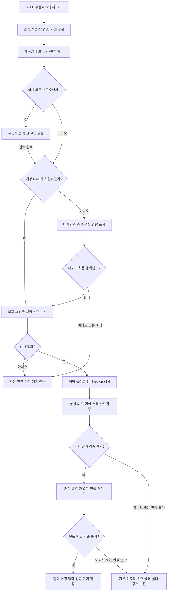
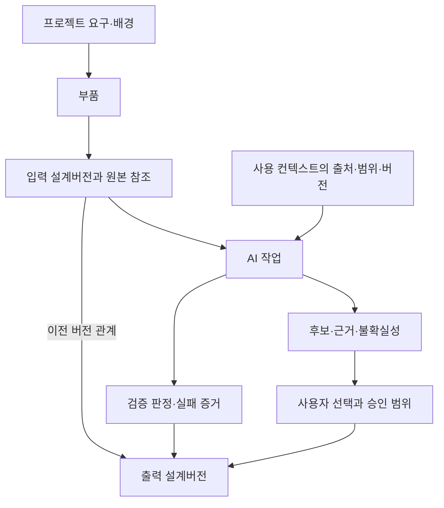
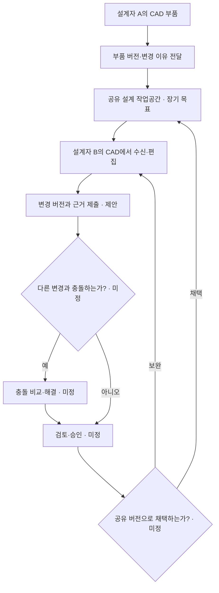

# CADBridge 제품 개념도

문서 버전 1.2.0 · 2026-11-16 KST. 서로 다른 CAD를 쓰는 사람이 설계와 변경 맥락을 전달하고, 받은 사람이 자신의 CAD에서 수정·저장하는 제품을 목표로 한다. 이 문서는 [요구사항](REQUIREMENTS.md)과 [결정 로그](DECISIONS.md)를 그림으로 정리한 설계 문서다. 제품 구현·CAD 선정·native 실행 검증은 완료되지 않았다.

## 표시와 범위

| 표시 | 뜻 | 현재 해석 |
|---|---|---|
| 합의 | 사용자와 정한 제품 방향·행동 원칙 | 구현 또는 시험 통과를 의미하지 않음 |
| 제안 | 엔지니어가 제시한 구조·처리 방식 | 상세 설계·검증 전 |
| 미정 | 선택 또는 명세가 아직 없음 | 임의 기본값으로 확정하지 않음 |

첫 단계는 **STEP → 편집 가능한 오픈소스 CAD native 부품**이다. 다음 단계는 **서로 다른 오픈소스 CAD A → B의 부품 수신·수정·저장**이다. 장기 목표인 다인 설계 협업과 CAD 버전 간 지원은 후속 범위다. CAD A/B의 이름·버전과 지원 부품은 아직 미정이다.

## 1. 제품의 입력에서 결과까지

아래 동작 원칙은 합의이고, 모듈 분리와 실행 경계는 제안이다. 실제 구현 흐름을 촬영하거나 실행해 얻은 그림이 아니다. STEP에서 관측한 형상은 원래 피처 이력이나 유일한 설계 의도를 증명하지 않는다.

입력·선택·대상 버전이 바뀌면 이전 승인을 재사용하지 않는 실행 경계를 제안한다. 결과 확정 직전에도 보호 조건·승인 범위를 재확인한다. 생성·저장 등 어느 단계의 오류든 실패 경로로 보내며, 검증 실패를 무제한 자동 재시도로 처리하지 않는다. 최종 공차가 미정인 결과는 탐색 결과로만 기록한다.

| 사용자가 보는 것 | 제품이 해야 하는 일 | 아직 정하지 않은 것 |
|---|---|---|
| 필수 조건·수정 금지 대상 입력 | 요구와 적용 대상을 보존하고 위반 실행 차단 | 입력 화면, 조건 표현, 단위·대상 확인 UI |
| 후보별 근거·편집 차이 | 의도 모호성은 선택 전 보류 | 후보 생성 방식·개수·순위·표현 |
| CAD 기능 차이와 대체안 | 허용된 대체만 실행하고 손실 공개 | 자동 대체 범위·권한 설정·승인 방식 |
| 받은 CAD 부품과 편집 결과 | 피처·스케치·치수·제약, 재계산·저장 지속성 확인 | CAD쌍·버전·지원 피처·조립체 범위 |
| 검증 결과와 실패 설명 | 형상·native·의도·권한·맥락을 별도 판정 | 지표·공차·최종 부품·합격 기준 |

관련 요구: [R-01~R-12](REQUIREMENTS.md). 상세 처리 원칙은 [구조](ARCHITECTURE.md), [AI 정책](AI_POLICY.md), [검증](VALIDATION.md)을 따른다.

## 2. 설계 데이터와 AI 작업 컨텍스트

설계 맥락을 보존한다는 방향은 합의다. 아래 연결 구조와 최소 보존 항목은 제안이며 데이터베이스 스키마·JSON 계약이 아니다. 각 AI 작업에서 실제 사용한 입력과 컨텍스트의 버전을 고정해, 결과를 다시 설명하고 검증할 수 있게 한다.

| 구분 | 예 | 반드시 구분할 정보 |
|---|---|---|
| 원본에서 직접 확인 | native 파일에서 읽은 치수·제약 | 파일·버전·읽기 경로·확인 한계 |
| 기하 측정 | STEP 형상에서 측정한 홀 지름 | 단위·측정법·오차·대상 면 |
| 사용자 요구 | 홀 위치를 유지하며 두께 변경 | 적용 대상·조건·변경 이력 |
| AI 가정 | 대칭 배열이 설계 의도일 가능성 | 가정 표시·근거·대안·선택 |

컨텍스트 보존 기간·삭제·접근·공유 정책, 저장 기술, 조립체의 버전 연결은 **미정**이다. 원시 대화 전체와 비공개 내부 추론을 저장하는 요구는 아니다. 상세 제안은 [데이터·컨텍스트](DATA_AND_CONTEXT.md)에 있다.

## 3. 장기 협업 목표와 개발 협업의 경계

아래 그림은 장기 제품 목표를 설명하는 **제안**이다. 검토·충돌 처리·승인 화면, 공유 저장소와 병합 방식은 **미정**이며 첫 단방향 완료 범위에 포함하지 않는다.

| 구분 | 목적 | 현재 범위 |
|---|---|---|
| GitHub의 개발 협업 | 제품 소스·문서·작업 카드·PR·에이전트 인계 관리 | 협업 규칙·템플릿·문서 검사 파일 준비. 실제 원격 반영 상태는 [상태·근거](STATUS_AND_EVIDENCE.md) 참조 |
| CADBridge의 제품 협업 | CAD 설계버전·변경 이력·맥락을 사람이 공유 | 장기 목표. 다인 공간·동시 편집·CAD 병합은 미구현·미검증 |

Git branch·PR을 준비하는 것만으로 CAD 설계 병합이 구현되지는 않는다. 첫 완료 기준은 B가 부품을 받아 수정·저장하는 단방향 경로이며 왕복·동시 편집·병합은 제외한다.

## 4. 미정 사항과 다음 결정

아래 번호는 이 문서의 미정 목록이며 신규 확정 요구나 API 계약이 아니다. 기술 조사·추천안·시험 설계는 엔지니어가 준비하고, 사용자는 제품 범위·보호 조건·대체 허용·최종 판정에 관한 선택을 한다.

| ID | 미정 또는 상세 설계가 필요한 것 | 다음에 준비할 근거·결정 | 영향 |
|---|---|---|---|
| U-01 | CAD A/B·버전·운영 환경 | 서로 다른 오픈소스 CAD 두 개의 공식 API·native 저장·재계산·라이선스 조사와 추천 | G0·G1, 어댑터 지원 범위 |
| U-02 | 지원 부품·피처·입력 정보 | 단일 부품과 STEP-only/native 정보군을 나눈 예제, 제한·미지원 목록 | 추론 평가와 기능 검증 구분 |
| U-03 | 공차 네 종류와 판정법 | 제조 공차, 입력·기하 공차, 재구성 허용오차, 솔버 잔차 각각의 단위·대상·수치·절차 | 최종 합격 판정 |
| U-04 | 공통 표현·솔버·어댑터 계약 | 단위·참조·출처·불확실성, 오류 분류와 지원 기능 계약 | 구현 구조와 상호운용성 |
| U-05 | 후보 생성·의도 선택 화면 | 후보별 근거·편집 차이·모호성 기준과 사용자 선택 기록안 | 선택 전 보류, 의도 검증 |
| U-06 | 자동 대체·승인·실제 인증 | 허용 연산·대상 버전·행위 주체와 권한 범위, 낡은 승인 차단안 | 보호 조건·권한 검사 |
| U-07 | 모델·비용·재시도 정책 | 모델/API 선택, 데이터 전송 범위, 비용과 재시도 상한 추천 | 실행 한도와 실패 복구 |
| U-08 | 컨텍스트의 보존·삭제·접근·공유 | 보존 범위와 기간, 사용자·조직 경계, 삭제·복구 정책안 | 추적 가능성과 다인 공유 |
| U-09 | 제품의 버전·다인 협업·충돌·병합 | 단방향 경로 이후의 공유·검토·충돌 사례와 제품 범위 | 장기 워크스페이스 |
| U-10 | 개발팀 담당·검토·병합 권한 | 실제 담당자, 필수 리뷰 수, branch 보호·CI·병합 정책 | GitHub·에이전트 협업 운영 |
| U-11 | 소유자 라이선스·유지보수·일정 | 코드·예제 이용 권리, 지원 주체와 버전 정책, 관문별 일정 | 배포·장기 지원 |

과거 M3의 제한 형상·시험 수치·반복 한도·공차는 이 표의 미정값을 대신하지 않는다. 현재 완료된 것은 문서 준비와 정적 검사 범위이며, CAD/API 실행 근거는 [상태·근거](STATUS_AND_EVIDENCE.md)에 별도로 기록한다. 다음 작업은 [CB-001 프로그램 조사](tasks/CB-001.md)와 [작업 보드](TASK_BOARD.md)의 T1부터다.
